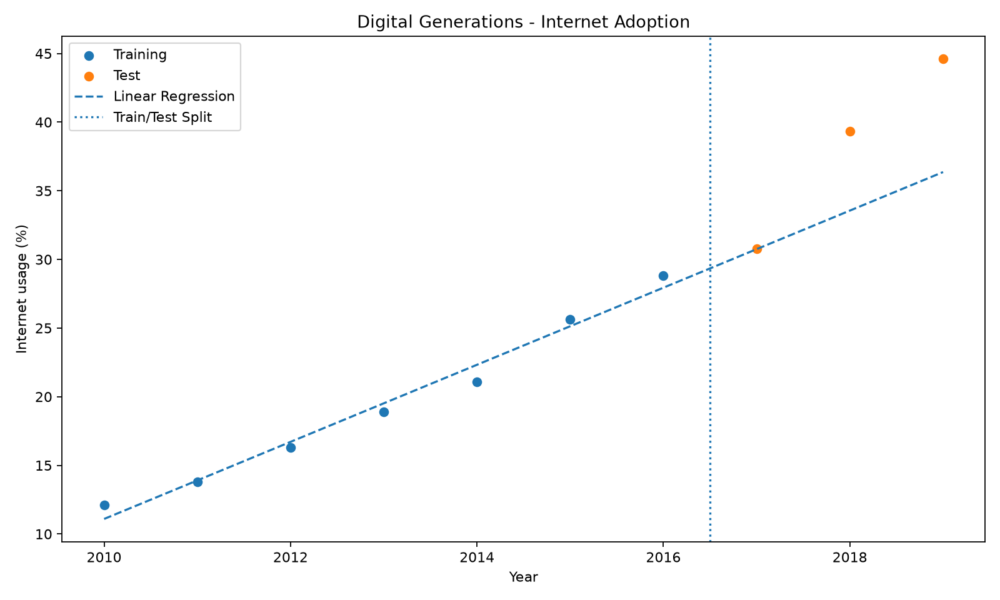

# Digital Generations

**Exploring Internet Adoption Among Older Adults Through Machine Learning**

Digital Generations is a personal machine learning project exploring how internet adoption has evolved among older adults in Italy.

The project uses publicly available Eurostat data to investigate historical trends and evaluate whether a simple linear regression model can estimate future internet adoption rates.

This is the first iteration of an ongoing project focused on digital inclusion, data analysis, and applied machine learning.

## Project Objectives

- Analyze historical internet adoption trends among Italian adults aged 65–74.
- Build a reproducible machine learning pipeline using Python.
- Evaluate predictions on chronologically separated data.
- Compare model performance against a simple baseline.
- Identify limitations and opportunities for future improvements.

## Dataset

**Source:** [Eurostat — Individuals: Internet Use](https://ec.europa.eu/eurostat/databrowser/view/isoc_ci_ifp_iu/default/table?lang=en)

The initial experiment uses the following subset:

| Attribute | Value |
|---|---|
| Country | Italy |
| Age group | 65–74 years |
| Indicator | Internet use within the last 12 months |
| Period | 2010–2019 |
| Observations | 10 |
| Feature | Year |
| Target | Internet usage (%) |

## Methodology

### Data Preparation

The dataset is loaded and processed using pandas. Observations are filtered by country, age group, indicator, and unit of measurement.

The pipeline checks for missing values and duplicate years, then sorts the observations chronologically.

### Model Training

A linear regression model from scikit-learn is trained using the year as the only input feature.

The dataset is split chronologically:

- **Training:** 2010–2016 (7 observations)
- **Testing:** 2017–2019 (3 observations)

This prevents future observations from being used to train a model evaluated on earlier years.

### Evaluation

Model performance is measured using Mean Absolute Error (MAE).

A constant baseline, which repeats the last observed training value (2016), is used for comparison.

## Results

| Model | Test MAE |
|---|---:|
| Linear Regression | 4.67 percentage points |
| Constant Baseline | 9.42 percentage points |

The linear regression model achieved approximately **50.4% lower MAE** than the baseline on the three test observations.

However, the model increasingly underestimated internet adoption during 2018 and 2019.

### Visualization

## Limitations

This initial experiment has several limitations:

- Only 10 annual observations are available.
- The model uses a single feature: year.
- Linear regression assumes a constant rate of change.
- Internet adoption cannot exceed 100%, making unrestricted linear extrapolation unsuitable for long-term forecasting.
- Performance is evaluated on only three observations, limiting the reliability of conclusions.

The results should therefore be interpreted as an educational experiment, not a validated forecasting system.

## Tech Stack

- **Python** — Core programming language
- **pandas** — Data loading and preprocessing
- **scikit-learn** — Model training and evaluation
- **Matplotlib** — Data visualization
- **pytest** — Automated testing

## Getting Started

**1. Clone the repository**

Clone the repository and navigate to its root directory.

**2. Create a virtual environment**

`python -m venv .venv`

Activate it using `source .venv/bin/activate` on macOS/Linux or `.venv\Scripts\activate` on Windows.

**3. Install dependencies**

`python -m pip install -r requirements.txt`

**4. Run the experiment**

`python main.py`

**5. Run tests**

`python -m pytest`

The program prints evaluation metrics and saves the visualization to `figures/regression.png`.

## Future Work

Potential improvements include expanding the historical dataset, comparing additional forecasting methods, incorporating demographic and socioeconomic indicators where available, and developing an interactive visualization interface.

Any new model will be evaluated against appropriate baselines using chronological validation.

## Data Attribution

Data provided by Eurostat, dataset `isoc_ci_ifp_iu`. Eurostat retains attribution and applicable reuse conditions for its published data.

---

**Project Status:** v0.1 — Initial Machine Learning Prototype

*Digital Generations is a learning-driven project developed to explore the relationship between technology adoption, data, and machine learning engineering.*
